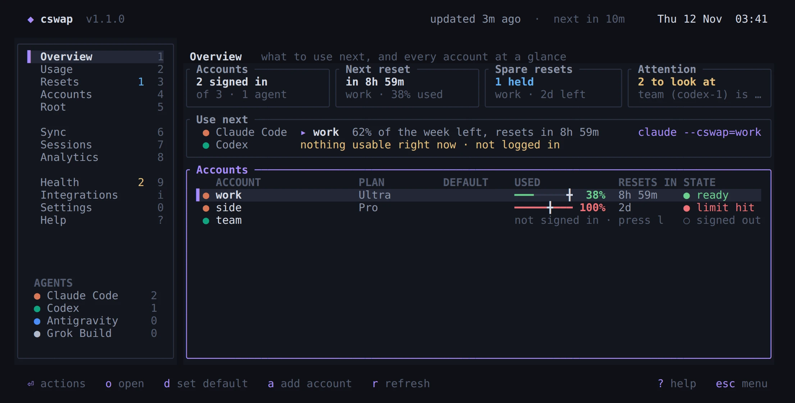
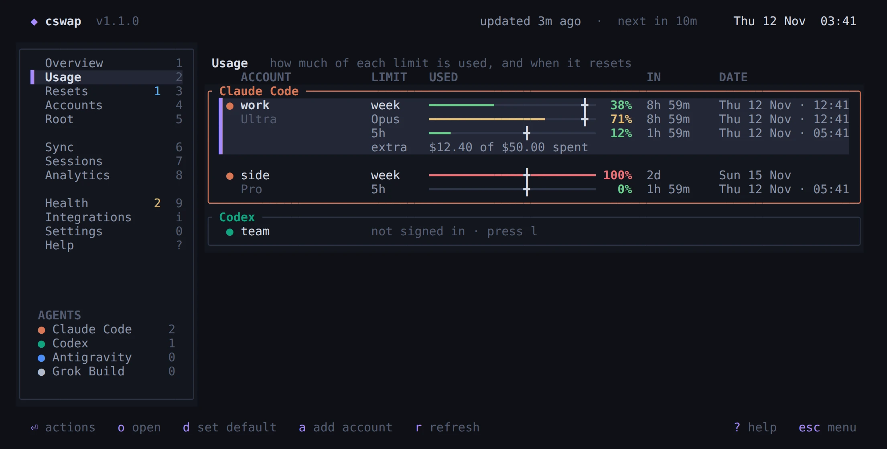
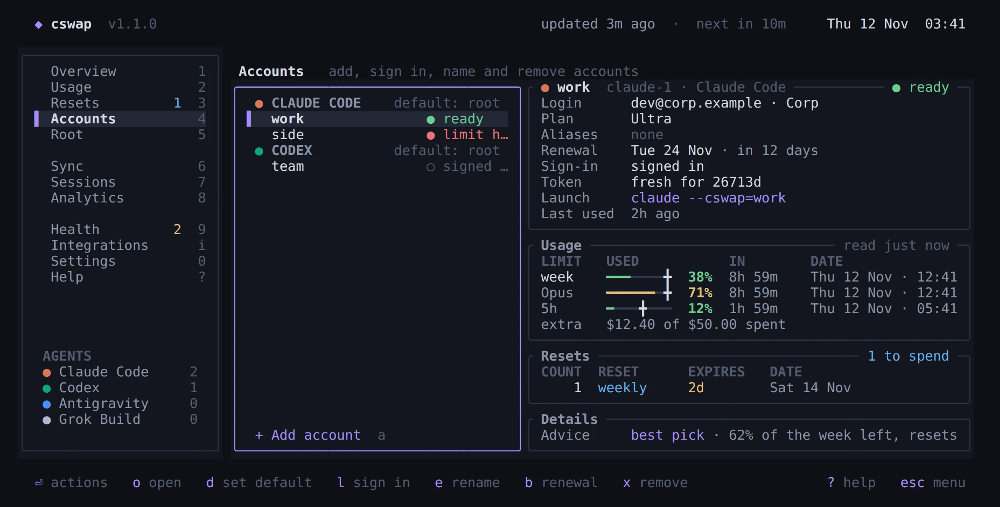
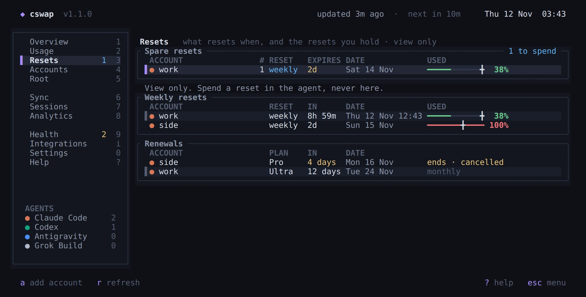
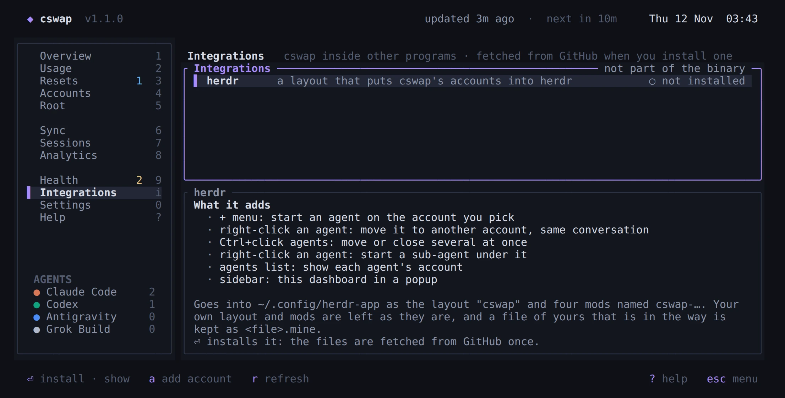
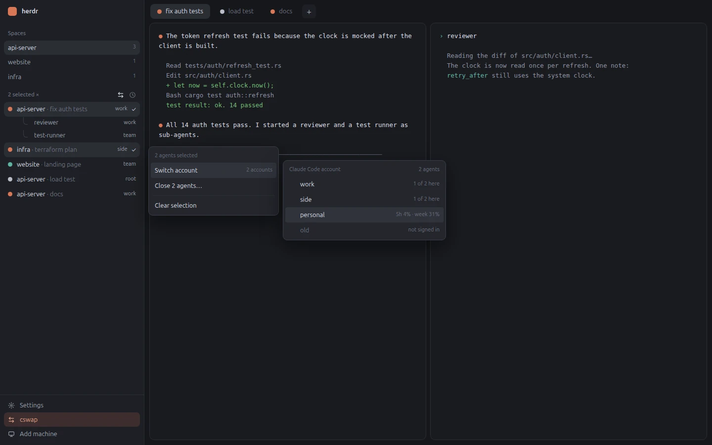

<h1 align="center">cswap</h1>

<p align="center">
  <b>One place for the accounts of your coding agents.</b><br>
  Claude Code · Codex · Grok Build · Antigravity
</p>

<p align="center">
  <a href="https://github.com/sidhanthapoddar99/claude-swap-rs/releases/latest"></a>
  <a href="https://github.com/sidhanthapoddar99/claude-swap-rs/actions/workflows/ci.yml"></a>
  <a href="LICENSE"></a>
  
  
  <a href="#herdr"></a>
</p>

<p align="center">
  <a href="#install">Install</a> ·
  <a href="#five-minute-tour">Tour</a> ·
  <a href="#the-dashboard">Dashboard</a> ·
  <a href="#herdr">herdr</a> ·
  <a href="#commands">Commands</a>
</p>

<p align="center">
  
</p>

One place for the accounts of your coding agents: **Claude Code**, **Codex**, **Grok Build** and **Antigravity** (`agy`).

- Keep several logins per agent, each under a name you choose, and start any of them with one flag: `claude --cswap=work`.
- See every account's weekly limits, when each resets, and which resets you still hold.
- Get told which account to use next, so a week that is about to reset is not wasted.
- Settings, history, skills and plugins are shared by every account of an agent. Only the login differs.

`cswap` is a single Rust binary for Linux, macOS and Windows. Starting an agent through it adds a few milliseconds and no network call. The agent then runs as itself: cswap replaces its own process with the agent's, so signals, exit codes and the terminal are the agent's own.

| Usage: every limit of every account | Accounts: one account in full |
| --- | --- |
|  |  |
| **Resets: what resets when, and the resets you hold** | **Integrations: cswap inside herdr** |
|  |  |

The pictures are drawn by the dashboard itself with made-up accounts; `scripts/shots.sh` makes them again.

## Install

**Linux and macOS**

```bash
curl -fsSL https://raw.githubusercontent.com/sidhanthapoddar99/claude-swap-rs/main/install.sh | bash
```

**Windows** (PowerShell)

```powershell
irm https://raw.githubusercontent.com/sidhanthapoddar99/claude-swap-rs/main/install.ps1 | iex
```

Both download the latest release, check its SHA-256, install the binary, and ask before they add the shell integration. `install.sh` takes `--yes`, `--no-modify-rc` and `--dir <path>`. `install.ps1`, saved to a file, takes `-Profile`, `-NoProfile`, `-NoModifyPath` and `-Dir <path>`.

**From source**

```bash
cargo install --git https://github.com/sidhanthapoddar99/claude-swap-rs
```

**Update**

```bash
cswap update          # install the latest release
cswap update --check  # only look
```

cswap looks for a newer release at most once every 24 hours, and only tells you. It never looks when it starts an agent. Turn the check off in Settings, or set `CSWAP_NO_UPDATE_CHECK=1`. To look right now, run `cswap update --check` or press Enter on "Check for updates now" in Settings.

### Shell integration

With it, the plain commands `claude`, `codex`, `agy` and `grok` go through cswap. Without it, type `cswap claude`, `cswap codex` and so on.

The easy way is the dashboard: **Settings, Shell tab**. It lists the shells on your machine with the agents each one wraps and the ones it does not. Press Enter on a shell, tick the agents, and save. cswap stores the list, and adds one line to that shell's rc file if the line is not there yet. Unticking an agent unwraps it. Open a new terminal to see the change.

By hand, the line is:

```bash
eval "$(cswap shell-init zsh)"        # ~/.zshrc; use bash in ~/.bashrc
cswap shell-init fish | source        # ~/.config/fish/config.fish
```

```powershell
Invoke-Expression (& cswap shell-init powershell | Out-String)   # $PROFILE
```

The line is the same whichever agents you wrap: `cswap shell-init <shell>` prints a wrapper for each agent ticked for that shell, and a shell you never chose for wraps every installed agent. cswap cannot write PowerShell's profile, so there it shows you the line to add.

`command claude` always skips cswap.

## Five-minute tour

```bash
cswap                     # open the dashboard
cswap add claude work     # add a Claude account named "work", then sign in
claude --cswap=work       # start Claude Code on it
claude                    # start it on its root login, as before
cswap use claude work     # make "work" the default: a plain `claude` starts there"
cswap suggest             # which account to use next, and why
```

Nothing changes until you add an account. The login you already have in `~/.claude`, `~/.codex`, `~/.gemini` or `~/.grok` is that agent's **root login**. cswap shows it on its own page, reads it and never writes to it.

## Accounts, root logins and the default

There are two kinds of login, and cswap keeps them apart.

- An **account** is a login cswap holds for you. Every account has a **name** (`work`); it is asked for when you add the account and cannot be left empty. An account can also have **aliases**, extra names it answers to. Names and aliases are unique within an agent.
- A **root login** is an agent's own login, the one in `~/.claude` and friends. Each agent has exactly one. It is called `root`, and it is listed on the Root page and by `cswap root`, not among your accounts.

The **default** is a different thing: it is where `cswap <agent>` starts when you name no account. Each agent has one default at most. Out of the box it is the root login. Make an account the default with `d` in the dashboard or `cswap use <agent> <account>`, and the Accounts page puts a ★ before its name; the Overview has a ★ in its DEFAULT column. With auto-pick on (Settings, Harness tab, or `cswap use <agent> auto`) there is no default: cswap takes the best account at every launch.

One login belongs to one account. If you sign a new account in as someone an account of that agent already holds, cswap says so and adds nothing. The one exception is the root login: an account may hold the same login as its agent's root.

To turn a root login into an account, press `c` on the Root page (or run `cswap add <agent> <name>`), name it, and sign in once more. cswap does not copy the root's login into the account. The vendors replace a login's token every time it is renewed, so two copies of one login sign each other out.

## How accounts work

Each agent keeps all its state in one directory, and each has an official way to point it somewhere else:

| Agent | Command | Its own dir | Moved with |
| --- | --- | --- | --- |
| Claude Code | `claude` | `~/.claude` | `CLAUDE_CONFIG_DIR` |
| Codex | `codex` | `~/.codex` | `CODEX_HOME` |
| Grok Build | `grok` | `~/.grok` | `GROK_HOME` |
| Antigravity | `agy` | `~/.gemini` | `--gemini_dir=` (experimental) |

A cswap account is a directory of its own that mirrors the agent's dir with links. Only the login and a few per-machine files are real:

```
~/.cswap/
  settings.json                     cswap's own settings, and the agents each shell wraps
  harness/claude/settings.json      per agent: the default, sync rules
  accounts/
    claude-1/
      settings.json                 name, aliases, identity, plan, last refresh and its data
      config_dir/                   what the agent is pointed at
        .credentials.json           real: this account's login
        .claude.json                real: who it is
        settings.json  -> ~/.claude/settings.json     \
        CLAUDE.md      -> ~/.claude/CLAUDE.md          |  links, made by sync
        projects/      -> ~/.claude/projects           |
        skills/        -> ~/.claude/skills            /
    codex-1/ …
```

What follows from this:

- **Install once, use everywhere.** A plugin, skill or MCP server set up under one account is there under every account of that agent.
- **History is shared.** Hit a limit, switch account, resume the same conversation.
- **New files are picked up by themselves.** Sync looks at the agent's dir before every launch, so a file a future version invents is linked without a cswap release.
- **The agent's own login is left alone.** cswap never writes into the agent's own dir. Your editor extension and anything else that reads it keep working.

### Sync

Sync runs before every launch and from the dashboard's Sync page. It links whatever is new, drops links whose target is gone, and reports **shadowed** entries: a real file in an account where a link should be, which means the agent wrote something there that is not shared. `cswap sync --repair` moves such files to `~/.cswap/parked/` and puts the link back. Nothing is deleted.

Each agent has a short built-in list of names that stay private (logins, identity, locks, caches). Add your own per agent in Settings.

## Starting agents

```bash
cswap claude [args…]            # the default
cswap claude --cswap            # pick from a list
cswap claude --cswap=work       # by name or alias
cswap claude --cswap=2          # by number
cswap claude --cswap=root       # the agent's root login
cswap claude --cswap=auto       # the best account right now
cswap claude --cswap=work,side  # the first of these that is free
cswap start                     # pick the agent, then the account
cswap start --default           # pick the agent, start on its default
```

Everything after the agent's name goes to the agent untouched, `--help` and `-h` included. The only arguments cswap takes out are `--cswap` and `--cswap=…`.

With the shell integration, `claude` is `cswap claude`, so every line above also works without the `cswap` in front: `claude --cswap`, `claude --cswap=work`.

Which account a launch uses, first match wins:

1. `--cswap=<account>` on the command line
2. `CSWAP_CLAUDE`, `CSWAP_CODEX`, `CSWAP_AGY` or `CSWAP_GROK` in the environment (`export CSWAP_CLAUDE=work` pins one terminal)
3. the agent's default: its `root` login, an account, or `auto`. Set it with `d` in the dashboard or `cswap use <agent> <account>`

An account answers to its name (`work`), its aliases, its key (`claude-2`), its number within the agent (`2`) and its email. `root` is the agent's own login; `default`, its name in earlier versions, still works.

`cswap ps` lists the agents that are running and which account each is on.

## The dashboard

Run `cswap` with no arguments. Keys: `1`–`9`, `i` and `0` or the arrow keys to move, `Enter` to act, `?` for the Help page. `Esc` steps back: out of a dialog, out of the page, then out of cswap. The mouse works too.

The pages are numbered in the order of the menu, so `1` is Overview; `i` is Integrations and `0` is Settings. `?` opens Help from anywhere, and a second `?` goes back.

| Page | What it shows |
| --- | --- |
| **Overview** | What to use next for each agent, and every account on one line. |
| **Usage** | Every limit of every account, in one box per agent: the plan under the name, then a line per limit with a bar and its pace marker, the percent used, how long until it resets and the date. The short windows of a few hours are listed here too. |
| **Resets** | Three parts: the spare resets you hold with how many and when they expire, when each account's weekly limit resets, and when each plan renews. Every row gives the account, the reset, how long until then, the date, and how much of the account's week is used. Selecting a row softly marks the same account's other rows in all three parts. |
| **Accounts** | Add, sign in, rename, set aliases, remove. For the selected account: its facts a line each, then every limit it has with its credits, then the spare resets it holds, then the details that explain them. Enter opens its actions in groups; `d` makes it the default of its agent. |
| **Root** | Each agent's own login and its usage, which account holds the same login, `c` to make an account from it, and `d` to make it the default again. |
| **Sync** | Per account: what is linked, what is private, what is shadowed, and when it was last synced. |
| **Sessions** | The agents running right now: which account each is on, since when, and in which folder. |
| **Analytics** | Burn rate per account over the last week and where it lands at the reset. More is planned. |
| **Health** | Anything that needs attention: signed-out accounts, two accounts on one login, shadowed files, a missing shell integration. |
| **Integrations** | cswap inside other programs. One so far: the [herdr](#herdr) layout, with what it adds, whether it is installed, and Enter to install or show it. The files are fetched from GitHub only when you install. |
| **Settings** | Three tabs; `t` and `T` move between them. General: the theme, refresh and updates, with a row that checks for an update now. Harness: every agent's options in one list. Shell: each shell with the agents it wraps, and a list of boxes to wrap or unwrap them. |
| **Help** | How to start an agent on an account with every flag, what cswap's words mean, and every key. |

Every bar, percent and countdown sits in the same column on every page. A countdown is as short as it can be: `3d` when it is more than two days off, `1d 6h` within two days, `4h 25m` within one. The exact date is on the Usage and Resets pages, always as a date such as `Sat 14 Nov`, with the time of day when it is within two days.

The colour of the dot in front of an account's name tells its agent, so the agent is not written again beside the name. The dot stays a dot on every page: the default account of an agent is marked with a ★ on the Accounts page only, and in the Overview's DEFAULT column. The `grey` theme has no colours, so there the agent's command follows the name, except on the Usage page, where each agent has its own box.

The weekly and monthly limits are what every page works with. The agents also have short windows of a few hours; cswap reads them to know when an account is rate limited right now, and lists them on the Usage page only.

Usage is fetched when the dashboard opens and then in one round every 10 minutes while it stays open (change it in Settings). Each login is asked once per round: a root login that an account also holds takes that account's answer. Two dashboards open at once share the rounds instead of each asking. After a rate limit an account is left alone for half an hour. Nothing is fetched in the background when the dashboard is closed, and starting an agent never fetches.

**Adding an account**: press `a`, pick the agent, type its name, press `Enter`. cswap steps aside and the agent's own sign-in runs in your terminal. When it finishes you are back in the dashboard with the new account. If the sign-in is abandoned, or another account already holds that login, nothing is added.

### Themes

Settings → General → Theme steps through six: `violet` (the one in the picture), `blue`, `green`, `dark` (true black), `grey` (no colour at all: how full a bar is shows as brightness) and `terminal`, which uses your terminal's own 16 colours and so follows the theme you already have. The choice is kept in `~/.cswap/settings.json` as `theme`.

### Resets are view only

cswap shows the resets an account holds and when they expire. It cannot spend one, and it never calls a vendor route that does. Spend a reset in the agent or on the vendor's site.

### Which account to use next

The suggestion follows one idea: use what you would otherwise lose. An account whose week resets soon with room left goes first, and so does a cancelled plan with days left. An account that is at its limit, signed out, or whose plan has ended goes last. `cswap suggest` prints the ranking with the reason for each line, and `--cswap=auto` uses the top one.

## herdr

[herdr](https://herdr.dev) keeps coding agents in terminals that stay alive. cswap ships a layout for it, called `cswap`, that puts your accounts where you start and watch agents:

<p align="center">
  
</p>

| Where | What you get |
| --- | --- |
| **+ menu** | Every agent has an arrow that opens its accounts, with how much of each is used. Pick one and the agent starts on it. "Best available" lets cswap choose. |
| **Right-click an agent** | **Switch account** shows the account it runs on and moves it to another one: the agent stops and starts again there, in the same conversation. **Add sub-agent…** opens the + menu and starts your pick under that agent, which is told about it. |
| **Ctrl+click agents** | Select several (Cmd+click on a Mac), then right-click one of them: move them all to one account, one after the other, or close them all. Switching needs agents of one kind; an agent in the middle of a turn stays where it is. |
| **Agents list** | The ⇄ icon beside the sort icon shows each agent's account in place of its time and status. Click it again to go back. |
| **Sidebar** | **cswap**, between Settings and Add machine, opens this dashboard in a popup over the window. |

The picture is a drawing with made-up names. The layout is not part of the binary: it lives in this repository under [`integrations/herdr/`](integrations/herdr), and cswap fetches the files that go with its version.

```
cswap herdr install            fetch the layout into ~/.config/herdr-app
cswap herdr install --show     the same, then switch the running herdr to it
cswap herdr status             whether it is installed and current
```

Or open the dashboard's **Integrations** page (`i`) and press Enter. An install writes only `layouts/cswap.*` and `mods/cswap-*`. Your own layout and mods stay as they are, and you switch back in herdr's settings or with `ctrl-shift-l`. A file of yours that is in the way is kept beside the new one as `<file>.mine`, never overwritten. To remove it, switch to another layout and delete those files.

Two keys you can bind in herdr's `keys.json`: `cswap-chrome.dashboard` opens the dashboard popup, and `cswap-agents.accounts` flips the accounts view.

### Moving a running agent from the command line

The layout's menus run these, and they work without it:

```
cswap herdr ls                 which account each terminal's agent runs on
cswap herdr info t7            the account the agent in terminal t7 runs on
cswap herdr switch t7 work     stop it, start it on `work`, same conversation
cswap herdr menu               every agent with its accounts, as JSON, for a launch menu
```

A switch stops the agent, then types the launch on the new account at the shell in its place, with the model and other options it had and the arguments that resume the conversation (`claude --resume <id>`, `codex resume <id>`, `grok --resume <id>`, `agy --conversation <id>`). The terminal, its tab, its place and its sub-agents stay as they are. It works because accounts share their conversations and differ only in the login.

An agent that a shell started is stopped with Ctrl+C, and the shell is there again. An agent that is the terminal's own program (`hc run claude …`) has no shell behind it and a clean exit would end the terminal, so cswap turns herdr's keeping on for it and kills the agent: herdr then puts a shell in its place.

It refuses when the agent is in the middle of a turn and when it cannot tell which conversation the agent is in. `--fresh` allows the second case and starts a new conversation. Finding the conversation reads `/proc`, so this is Linux only for Codex and Antigravity; the Antigravity part is not yet tested against a running agy.

## Commands

```
cswap                      open the dashboard
cswap <agent> [args…]      run an agent on the account it starts on
cswap start [--default]    pick an agent and an account, then run it

list                       every account and its state        (--json)
root                       the agents' own logins             (--json)
ps                         which agents are running, on which account
usage [account]            weekly limits and when they reset  (--refresh)
resets                     spare resets and what resets when
suggest [agent]            which account to use next, and why

add <agent> <name>         add an account and sign in
login <account>            sign in again
rename <account> <name>    give an account another name
alias <account> [names…]   show or set its extra names        (--clear)
use <agent> [account]      show or set the agent's default
remove <account>           delete an account's login          (--yes)

refresh [account]          fetch usage now
sync [account]             bring links up to date             (--check, --repair)
doctor                     check for problems
migrate                    move cswap 0.6 profiles into ~/.cswap
shell-init <shell>         print shell integration
herdr ls|info|switch       agents in herdr terminals: account and switch
herdr install|status       the cswap layout for herdr
update                     install the latest release         (--check)
```

`cswap -h` prints this with examples. `cswap <command> -h` explains one command.

## What each agent reports

| | Limits | Spare resets | Plan | Renewal date |
| --- | --- | --- | --- | --- |
| Claude Code | week, per-model week, extra usage | count and expiry | yes | set by hand |
| Codex | week | count and expiry | yes | yes |
| Grok Build | monthly credits | not reported | yes | not reported |
| Antigravity | week of the Gemini models, through `agy /usage` | not reported | not reported | not reported |

Where the vendor does not report a renewal date or a reset, you can note it by hand on the Accounts page.

The plan is read again whenever usage is fetched and whenever the dashboard opens. For Claude Code it comes from Claude Code's own login files, not from Anthropic: the plan's name when the files carry it, else the rate-limit tier in the profile, else the tier stored with the token. The profile comes before the token because the token keeps the tier it had at sign-in, which can be a plan behind after an upgrade. A plan you typed by hand is never overwritten.

## What cswap does and does not do

- It **never renews a token**. Each agent renews its own login when it runs. An account you have not started for a while can show its last known usage until you start it or sign in again.
- It **never writes** into an agent's own config dir.
- It writes **one line into a shell's rc file**, and only when you save a selection for that shell in Settings, or say yes to it in the installer. The line is added at the end and nothing else in the file is touched.
- It calls **only the endpoints the vendor's own CLI calls** for usage: `api.anthropic.com`, `chatgpt.com` and `cli-chat-proxy.grok.com`, each with that account's own login. For Antigravity it runs `agy` itself. Claude lists spare resets only to its CLI, so cswap identifies as the CLI for that one read. Turn that off per agent in Settings (`cli_identity`) and the reset details are skipped.
- It contacts `api.github.com` once a day to look for a new release, unless you turn that off.
- No telemetry.

Logins are stored the way each agent stores them, in files only you can read (`0700` directories, `0600` files).

## Coming from cswap 0.6

0.6 handled Claude Code only and kept profiles in `~/.local/share/cswap`.

```bash
cswap migrate
```

Each old profile becomes a Claude account. Its first alias becomes its name and the rest stay as aliases; a profile with no usable alias is named after its email. The profile's directory is moved, and a link is left at the old path so that paths recorded by Claude still resolve.

| 0.6 | now |
| --- | --- |
| `cswap login <name>` | `cswap add claude <name>` |
| `cswap activate <name>` | `export CSWAP_CLAUDE=<name>` |
| `cswap run <name>` | `cswap claude --cswap=<name>` |
| `cswap watch` | `cswap` (the dashboard) |
| `cswap upgrade` | `cswap update` (`upgrade` still works) |

## Platforms

| | Status |
| --- | --- |
| Linux | Developed and tested here. |
| macOS | Built in CI. Claude Code keeps its login in the keychain there, which cswap reads with `/usr/bin/security`. Not yet tested on a real Mac. |
| Windows | Built in CI. The agent runs as a child process, since Windows cannot replace a process. Linking needs Developer Mode or an elevated shell. Not yet tested on a real PC. |

`cswap ps` and the Sessions page read `/proc` on Linux and see every session. On macOS and Windows they list the sessions that were started through cswap.

## Environment

| Variable | Effect |
| --- | --- |
| `CSWAP_HOME` | where cswap keeps its data (default `~/.cswap`) |
| `CSWAP_CLAUDE`, `CSWAP_CODEX`, `CSWAP_AGY`, `CSWAP_GROK` | the account a launch uses in this environment |
| `CSWAP_CLAUDE_BIN`, … | the real binary, when it is not the first on `PATH` |
| `CSWAP_NO_UPDATE_CHECK` | never look for a newer release |
| `CSWAP_INTEGRATIONS` | a checkout's `integrations/` folder to install the herdr layout from, in place of GitHub |
| `HERDR_APP_HOME` | herdr's folder, when it is not `~/.config/herdr-app` |
| `NO_COLOR` | plain text output |
| `CSWAP_ACCOUNT` | set by cswap for the agent it starts: the account's key |

## Uninstall

Remove the shell integration line from your rc file, delete the binary, and delete `~/.cswap`. The accounts' logins live there, so sign in to anything you still need first. The agents' own directories were never changed.

## Develop

```bash
cargo test                                   # unit tests and end-to-end tests of the binary
cargo clippy --all-targets -- -D warnings
CSWAP_SHOW=1 cargo test every_page -- --nocapture   # print every dashboard page
scripts/shots.sh                             # make the pictures in docs/img again (needs a Chromium-family browser and ImageMagick)
```

Tests run in a fabricated home with shell scripts standing in for the agents. They never touch your logins or the network.

Inspired by [claude-swap](https://github.com/realiti4/claude-swap).

## License

See [LICENSE](LICENSE).
