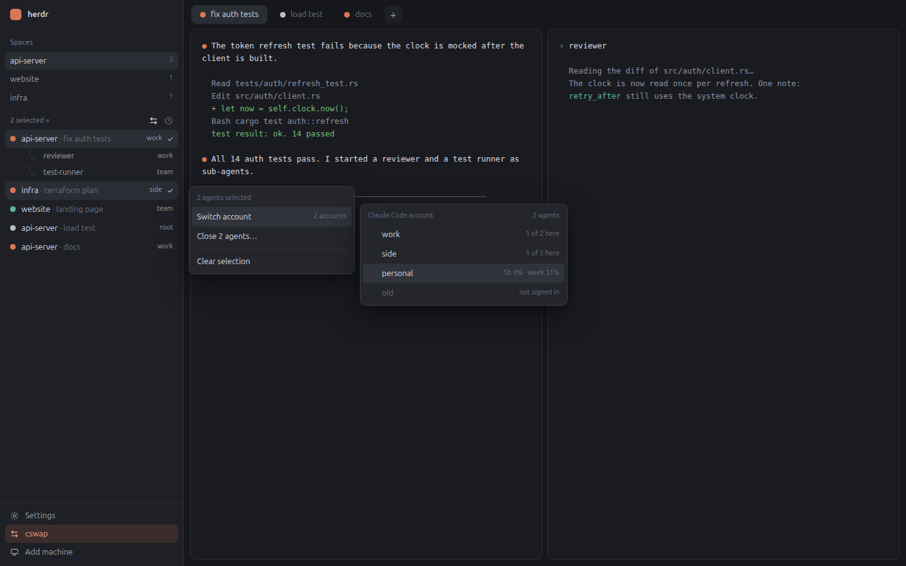

# cswap

Herdr's main layout with your [cswap](https://github.com/sidhanthapoddar99/claude-swap-rs) accounts in it. You start an agent on the account you pick, see which account every agent runs on, move a running agent to another account without losing its conversation, and open the cswap dashboard in a popup. Everything else looks and works like the shipped `main` layout.

The preview is a drawing with made-up spaces and accounts.

Install it with `cswap herdr install --show`, or from the Integrations page of the cswap dashboard. It needs `cswap` 1.2 or later on this machine.

## What you see

Left to right: the sidebar (268px), then the tab bar over the panes, as in `main`.

- **Sidebar, top to bottom:** the brand row (46px), the spaces list, the agents list, and a footer of three rows (97px): Settings, **cswap**, Add machine. The cswap row has a two-arrow icon (`mods/cswap-chrome/cswap.svg`).
- **Agents list header:** "Agents" at the left; at the right the two-arrow icon and the sort icon, 14px, dim until hovered. With agents selected the title reads "N selected ×".
- **Agent rows (30px) and sub-agent rows (26px):** as in the shipped list. In the accounts view the time and the status give way to the account's name, 11px, muted; an agent cswap cannot place shows "–". A selected row has the selected background and a check at its right.
- **+ menu (300 × 512 popup):** the shipped new-tab menu. Every agent row that has accounts ends in an arrow button; it opens that agent's accounts in place of the list: a ★ on the default, the name, a usage note at the right (`5h 12% · week 40%`), a digit key each, and "Best available" at the top.
- **Agent menu (264 × 177 popup):** Copy agent ID, Switch account (the account in use at the right), Add sub-agent…, a rule, Restart agent, Close agent tree…. Restart agent is off, with "in a turn" at its right, while the agent is working or blocked.
- **Account list (320px wide popup):** one 31px row per account: a check on the one in use, the name, and "in use", the usage note or "not signed in". A line under the rows says why a switch is refused, when it is.
- **Group menu (264 × 173 popup):** "N agents selected", Switch account (the shared account, "N accounts" or "different agents"), Restart N agents ("M of N" at its right when some cannot restart now), Close N agents…, a rule, Clear selection.
- **Dashboard (dialog, 86% × 88% of the window):** a 34px bar with the title "cswap" and a ✕, over a terminal running `cswap dashboard usage`: the dashboard, opened on its Usage page.

## How it behaves

- Agent statuses (working, blocked, done, idle) look and sort exactly as in the shipped agents list.
- **+ menu:** a click on an agent starts it as before (on cswap's default for it). The arrow opens its accounts; a click or its digit starts the agent with `cswap <agent> --cswap=<account>` in a new tab. Escape or the back row returns to the list.
- **Right-click an agent or sub-agent:** the agent menu. Switch account opens the account list; a click on an account closes it and the agents list runs `cswap herdr switch <terminal> <account> --json`. The row reads "switching…" until it ends, then a toast says "t7 is on work · Same conversation." or why it was not moved. When cswap cannot tell the conversation, a dialog asks before starting a new one (`--fresh`).
- **Restart agent:** the menu closes and the agents list runs `cswap herdr restart <terminal> --json`: the agent is stopped and started again on the account it is on, in the same conversation and the same terminal, as the program that is on disk now. That is how an update to the agent, to cswap or to the agent's settings takes hold. The row reads "restarting…" until it ends, then a toast says "t7 restarted on work · Same conversation." or why it was not restarted. When cswap cannot tell the conversation, a dialog asks before starting a new one (`--fresh`).
- **Sub-agents at work:** when `cswap herdr info` lists terminals under the agent that are in a turn (`children_working`), Switch account and Restart agent open a dialog first: "Restart t7 while its sub-agents work?", naming them and saying that a report sent while t7 is stopped is lost. "Restart anyway" or "Switch anyway" passes `--force`. Restart agent shows "2 working below" at its right. In a selection such an agent stays as it is ("stays: sub-agents working").
- **Add sub-agent…:** opens the + menu titled "Start a sub-agent of t7". The pick starts under that agent with `hc run --parent`, is shown with `terminal.peek`, and the parent is told with `hc send`. With no account picked it starts on the default of its agent, as every launch does.
- **Ctrl+click (Cmd+click on a Mac):** adds a row to the selection or takes it out. A plain click drops the selection. A right-click on a selected row opens the group menu; on any other row it drops the selection and opens the agent menu.
- **Group switch:** the account list shows "N of M here" per account. A pick moves every selected agent that can move and is not there already, one after the other; agents in the middle of a turn, with an unknown conversation or without a cswap account stay and are listed under the rows. One toast sums it up.
- **Group restart:** restarts every selected agent that is between turns and whose conversation cswap can find, one after the other; the rest stay as they are. Agents of different kinds can be restarted together. One toast sums it up.
- **Group close:** a dialog names the terminals; confirming closes each one's tree.
- **Two-arrow icon in the header:** flips the accounts view. It reads `cswap herdr ls --json` when turned on and every 30 seconds while on. It is off at every start.
- **cswap in the footer:** opens the dashboard dialog on the Usage page, reusing a running dashboard terminal as it was left. The ✕ ends that terminal and closes the dialog.
- **Keys:** nothing is bound. `cswap-chrome.dashboard` and `cswap-agents.accounts` are commands a `keys.json` can bind.

## Built from

- **Layout:** `layouts/cswap.json`, a copy of `main` with three mods swapped: `agents` → `cswap-agents`, `tabs` → `cswap-tabs`, and the footer's `workspace-chrome` block → `cswap-chrome` at 97px (it was 69px). Its picture is `layouts/cswap.svg`.
- **`cswap-agents`** (clone of `agents`): the list, its menus and dialogs, chosen by `props`: `agentAddress` (the agent menu), plus `accounts` (the account list), `confirmSwitch`, `confirmClose`, `group` and `infos` (a selection), or `sortMenu`. A popup may die with its task, so menus only ask: they put a job in `shared("cswap.switch")` (a switch, or a restart when the job has `restart` set) or `shared("cswap.spawn")`, and the list, which lives on, takes it in `render` and does the work. `shared("cswap.clear")` ends a selection.
- **`cswap-new-menu`** (clone of `new-menu`): loads `cswap herdr menu` once and keeps it in `shared("cswap.menu")`. With `props.parent` it hands the pick to the list as a `cswap.spawn` job instead of `tab.new`.
- **`cswap-tabs`** (clone of `tabs`): only its + opens `cswap-new-menu`.
- **`cswap-chrome`** (clone of `workspace-chrome`): the footer row, and `openOverlay({ kind: "dialog", modal: true, layout })` with a `{ terminal }` block for the dashboard.
- **Shipped mods used as they are:** `workspace-chrome` (brand row), `spaces`, `pane`, `files`, `changes`, `workspace-status`. The clones take their icons from `mods/workspace-chrome/` and `mods/tabs/`.
- **Programs run:** `cswap` (`herdr menu`, `herdr ls`, `herdr info`, `herdr switch`, `herdr restart`, and the dashboard itself), found on the PATH, then in `~/.local/bin` and `~/.cargo/bin`; `hc` (`run`, `send`, `ls`); and `sh` once to read `$SHELL`. Nothing reaches the network; cswap reads this machine's processes and its own stored usage.
- **herdr functions:** `agents`, `terminals`, `panes`, `spaces`, `focused`, `shared`/`setShared`, `openOverlay`/`closeOverlay`, `run`, `hc`, `exec`, `notify`, `nextCommand`, `setAgentOrder`.

## Watch out

- A terminal whose program is the agent itself (`hc run claude …`) ends when the agent exits cleanly. `cswap herdr switch` and `cswap herdr restart` handle it (they turn keeping on and kill the agent, so herdr puts a shell there); do not stop such an agent from the mod.
- Work started inside a popup can die when the popup closes. Keep the hand-off through `shared`.
- A job older than 10 seconds is dropped, never run late.
- `hc send` wraps text in `<hc from>` when `HC_TERMINAL_ID` is set; cswap removes it for its own calls.
- cswap sees this machine only: for an agent on another machine the account items are off.
- While an agent is stopped its terminal is a bare shell, and herdr types whatever is sent to that terminal into it: a sub-agent's report is lost there. That is why agents with sub-agents at work are asked about, never moved silently.
- A switch or a restart takes several seconds per agent (stopping, the shell coming back, the launch being typed), so a group moves in turn.
- An agent with no cswap account (a program cswap does not know) cannot be moved; its Switch account item is off.

## Done when

- `herdr-app check` passes for the four mods and `herdr-app status` lists no errors with the layout shown.
- The + menu lists each installed agent, and an agent's arrow lists the accounts `cswap list` shows.
- `herdr-app do cswap-agents.accounts` puts an account name on every agent row that `cswap herdr ls` knows.
- Switch account on an idle agent ends with the same conversation open on the other account, in the same terminal, with its sub-agents still under it.
- Restart agent on an idle agent ends with the same conversation open on the same account, in the same terminal, under a new process.
- Ctrl+click on two agents, then a right-click, shows "2 agents selected".
- `herdr-app do cswap-chrome.dashboard` opens the dashboard over the window, and ✕ closes it and ends its terminal.
